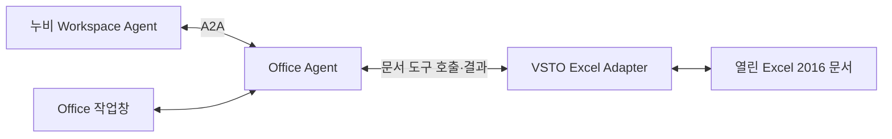

# 누비 Workspace와 Office Agent의 A2A 연결 제안

작성일: 2026-10-13. Office 2016 · Windows는 확정된 대상이며, A2A 연결은 사용자 제안을 구체화한 설계 방향이다. Excel 자체 실행 경로는 구현했으며 A2A 연결 구현은 아직 없다.

## 사용자 관점

Office 추가 기능을 설치하고 Excel 안의 작업창에서 요청한다. 이후 누비 Workspace에서도 같은 Office Agent에 업무를 맡길 수 있게 한다. Excel에서 시작한 모든 요청이 누비 Workspace를 왕복해야 하는 구조로 강제하지 않는다.

누비는 “선택한 표의 금액 열을 채워줘”라는 업무를 맡긴다. Office Agent는 선택 범위와 관련 셀을 읽고 수정안을 만들며, VSTO 실행 후 수식·계산값을 확인해 결과를 보고한다. 누비가 COM 객체를 직접 조작하지 않는다.

A2A는 독립된 Agent 사이의 작업 위임과 결과 교환에 사용한다. 셀 읽기·수식 입력 같은 Office Agent 내부 도구는 별도의 계약으로 둔다. 도구 호출을 위해 MCP를 추가하는 것은 최초 구현의 필수 조건이 아니다. [A2A 공식 설명](https://a2a-protocol.org/latest/)

## 논리 구조와 실행 프로세스

추가 기능 형태의 제품이라도 Agent 런타임 전체를 Excel 프로세스에 넣을 필요는 없다. 초기 제안은 VSTO가 작업창과 Office 객체 접근을 맡고, 로컬 Office Agent 프로세스가 모델 통신과 A2A 연동을 맡는 것이다. 연결이 끊어지면 실행 중인 수정 상태를 보존하고 다음 작업을 중단한다.

로컬 IPC 방식, 프로세스 실행·종료 주체와 런타임 배포는 기존 누비 코드를 검토한 뒤 정한다. 같은 Windows PC에서 사용하는 구성을 우선 제안하며, 다른 PC와 연결하는 원격 구성을 기본 가정하지 않는다.

이 구성은 구현 제안이지 A2A 규격이 요구하는 배치는 아니다. A2A endpoint를 Workspace의 기존 작업 교환 서비스가 제공할지 Office Agent가 직접 제공할지는 기존 연결 방식에 맞춘다.

## A2A로 교환할 정보

| 정보 | Office X에서 필요한 내용 |
| --- | --- |
| 기능 안내 | Excel 작업 종류, 지원하지 않는 기능, 프로토콜 버전과 인증 조건 |
| 작업 요청 | 작업·메시지 ID, 요청 내용, 세션에 묶인 문서 참조, 허용한 작업 범위 |
| 진행 상태 | 수신, 실행 중, 사용자 입력 필요, 완료, 실패, 취소 |
| 결과 | 적용 셀, 수식, 허용된 범위의 계산 결과, 검증 상태, 저장 여부 |

Agent Card와 Task 등 표준 객체에 맞추되 문서 식별자·변경 내역은 버전이 있는 애플리케이션 데이터 계약으로 정의한다. 위 표는 wire schema가 아니다. 실제 필드와 상태 매핑은 사용할 규격·SDK 버전에 고정한다. [A2A 규격](https://a2a-protocol.org/latest/specification/)

문서 권한은 로컬 세션에 연결하며 요청 문자열의 파일 경로만으로 임의 문서를 열지 않는다. 수정안의 확인 주체를 한 곳으로 정하고 같은 적용을 두 UI에서 중복 실행하지 않는다. 전달 완료와 문서 검증 완료를 별도 필드로 보고한다. 저장하지 않았다면 `saved=false`를 명시한다.

## 기존 누비 코드에서 확인한 재사용 후보

2026-10-13에 현재 로컬 소스의 관련 선언과 연결 코드를 읽어 확인했다. 이 확인은 테스트 실행이나 Windows 호환성 검증이 아니다.

- `/Users/ganadi/Documents/llm_router/packages/nubi-a2a/package.json`: 공통 A2A 모듈과 `@a2a-js/sdk` 1.2.0 의존성이 있다.
- `/Users/ganadi/Documents/llm_router/packages/nubi-a2a/task-agent.mjs`: Agent Card, 작업 상태, JSON-RPC, 요청 범위와 메시지 중복 검사 코드가 있다.
- `/Users/ganadi/Documents/llm_router/packages/nubi-office/worker/main.mjs`: A2A 수신부와 Office 작업 처리 연결이 있다.
- `/Users/ganadi/Documents/llm_router/packages/nubi-office/worker/office-tasks.mjs`: 위임받은 작업과 실제 Office 실행을 연결하고 결과를 반환하는 코드가 있다.

재사용 전에는 이 계약과 Office X 문서 세션·사전조건·재조회 결과 계약을 대조한다. A2A 모듈은 아직 복사하거나 수정하지 않았다. 후속 확인에서 기존 Office의 VSTO 진입점을 찾았고 이번 Excel 구현에 일부 재사용했다. 현재 누비 Workspace의 실제 실행 제품과의 연결도 별도로 검증한다. 기존 저장소에는 Desktop A2A 비활성 결정이 남아 있으므로 현재 호스트 기능을 확인한 후 통합한다. [재사용 검토](reuse-audit.md)

## 첫 연결의 완료 조건

1. Excel 추가 기능 자체에서 읽기·수식 적용·재조회를 통과한다.
2. 누비에서 같은 업무를 위임하고 Office 작업창에 요청 출처와 대상 문서가 표시된다.
3. Office에서 검증한 결과가 동일 작업 ID로 누비에 돌아온다.
4. 통신 재시도는 문서 수정을 중복 실행하지 않는다.
5. 대상 문서 닫힘, 취소, 사용자 편집 충돌과 부분 적용을 양쪽이 같은 상태로 이해한다.

NASCA 문서와 실제 모델을 연결하는 검증은 별도 수행한다. A2A 연결 성공만으로 보호 문서 처리 성공을 판정하지 않는다.
