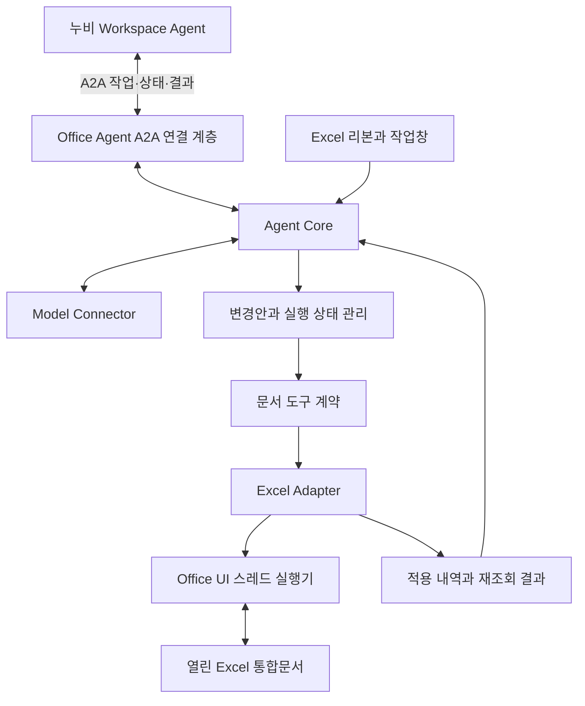

# 0.6.0 현재 구성

원본 GenOffice AgentLoop → 누비 인증 모델 transport → Office/native 도구와 원본 검색·미디어·PPTX·PDF 엔진을 연결한다. VSTO가 현재 문서·승인·실제 읽기 및 쓰기·DPAPI 스냅샷을 소유한다. 새 문서 생성 후 실행 대상을 재연결하고 새 작업창에 결과를 전달한다. UI는 누비 Workspace 원본 컴포넌트와 토큰을 공유한다. A2A는 아직 활성화하지 않았다. 아래는 초기 설계 기록이며 현재 범위는 [기능 대응](genoffice-capabilities.md)을 따른다.

# Office X 아키텍처 초안

작성일: 2026-10-13. 사용자가 제공한 VSTO + GenOffice 방향을 구현 가능한 책임 경계로 정리한 문서다. GenOffice 원본을 사용하는 첫 Excel 기능을 소스로 구현했다. 실제 지원 범위와 검증 결과는 [구현 결과](implementation-status.md)를 따른다. Windows 실환경 동작은 아직 검증하지 않았다.

## 1. 역할 분리

| 제안 모듈 | 책임 |
| --- | --- |
| OfficeX.ExcelAddIn | VSTO 수명주기, 리본, 작업창, 창별 대상 표시 |
| OfficeX.DocumentContracts | 직렬화 가능한 맥락·명령·결과 DTO와 도구 인터페이스 |
| OfficeX.ExcelAdapter | 대상 식별, 범위 조회, 사전조건 검사, 수식 적용, 계산·재조회 |
| OfficeX.AgentCore | 요청·계획·도구 호출·검증 상태, 취소, 반복 한도 |
| OfficeX.ModelConnector | 모델 통신, 인증, 응답 파싱, 타임아웃 |
| OfficeX.ChangeReview | 변경안 표시, 실행 전 재검사, 부분 적용 및 복구 상태 표시 |
| OfficeX.A2ABridge | 누비 작업 수신, Office 실행과 작업 ID 연결, 진행·취소·결과 교환 |

Agent Core와 Contracts는 Excel COM 참조에 의존하지 않는다. COM 객체를 모델 통신이나 다른 프로세스로 넘기지 않고 값으로 복사한 DTO만 사용한다. Agent의 배치 위치와 관계없이 Excel Adapter는 VSTO 측에 둔다.

## 2. GenOffice에서 참고하는 범위

GenOffice는 Agent Core, 모델 provider, 문서 엔진을 구분한다. Office X는 Agent Core와 AI Provider 원본을 직접 사용하며 문서 실행기는 열린 Office의 객체 모델을 사용한다. [GenOffice 개발 문서](https://github.com/genspark-ai/genoffice/blob/main/CONTRIBUTING.md)

범위 읽기, 구조화된 편집 명령, 실행 전 검사와 수정 후 확인을 도구 계약에 반영한다. [GenOffice CLI 문서](https://github.com/genspark-ai/genoffice/blob/main/packages/cli/README.md)

사용자의 후속 결정에 따라 GenOffice agent-core와 ai-provider 원본을 도입했다. 대상 커밋, 파일별 해시, LICENSE와 NOTICE를 보존했으며 [재사용 내역](reuse-audit.md)에 기록했다. 현재 공개 저장소는 Apache-2.0을 표시하며 `ee/`는 별도 조건으로 안내하므로 일괄 취급하지 않는다. [라이선스](https://github.com/genspark-ai/genoffice/blob/main/LICENSE), [기여 문서](https://github.com/genspark-ai/genoffice/blob/main/CONTRIBUTING.md)

## 3. 최초 문서 도구

| 도구 | 입력·출력의 핵심 | 첫 범위 |
| --- | --- | --- |
| read_selection | 요청 시점의 문서·시트 식별자, 선택 주소, 값·수식 | 단일 직사각형 범위 |
| read_range | 문서·시트 식별자와 주소 → 값·수식 및 비교용 스냅샷 | 명시한 범위만 읽기 |
| set_formula | 수정안 ID, 문서·시트, 셀 주소, 수식, 사전조건 → 셀별 적용 상태 | 단순 곱셈 수식 |
| calculate_and_read | 대상 범위 → 적용 수식, 계산값, 셀 오류, 계산 완료 여부 | 첫 예제의 입력·결과 범위 |

`set_values`, `format_range`, 표 구조 변경은 첫 검증 이후 추가한다. 첫 PoC는 최대 100개 데이터 행으로 제한하고 병합 셀·배열 수식·필터로 숨긴 행·여러 선택 영역·외부 참조를 명시적으로 지원 범위 밖으로 처리한다.

## 4. 문서 대상과 충돌 처리

- 통합문서와 시트에 열려 있는 세션 동안 유효한 식별자를 부여한다. 경로와 표시 이름만으로 대상을 찾지 않는다.
- 요청 시작 시 대상 식별자를 고정한다. 모델 응답 이후의 ActiveWorkbook이나 ActiveSheet를 수정 대상으로 사용하지 않는다.
- 문서가 닫히거나 시트가 삭제되면 기존 식별자를 무효화한다. 재개방한 문서는 새 세션이다.
- 수식 대상뿐 아니라 판단에 사용한 입력 범위의 값·수식도 스냅샷에 포함한다. 적용 직전 다시 읽어 사용자 편집이나 재계산으로 달라졌으면 재계획한다.
- 변경안 확인 후에도 사전조건을 재검사한다. 오래된 변경안은 자동 적용하지 않는다.
- 주소, 범위 크기, 수정 가능 상태와 수식 지원 범위를 실행기에서 검사한다. 모델의 선언을 검사 결과로 신뢰하지 않는다.

## 5. Office 실행과 결과 판정

VSTO는 Office가 로드하는 관리 코드에서 객체 모델에 접근한다. Office 객체 모델은 스레드 안전하지 않으므로, 우리 구현은 Office UI 스레드로 문서 접근을 모으고 모델 통신은 비동기로 처리한다. [VSTO 아키텍처](https://learn.microsoft.com/en-us/visualstudio/vsto/architecture-of-vsto-add-ins?view=vs-2022), [Office 스레딩](https://learn.microsoft.com/en-us/visualstudio/vsto/threading-support-in-office?view=vs-2022)

- UI 스레드에서 모델 응답을 동기 대기하지 않는다.
- Office가 편집 중이거나 모달 대화상자를 띄운 경우 대기·제한된 재시도·실패를 구분한다.
- 수정 명령을 재시도하기 전에 현재 상태를 재조회한다. 결과가 불명확한 쓰기를 무조건 반복하지 않는다.
- 같은 실행 ID를 중복 적용하지 않도록 세션 내 실행 기록을 유지한다. 프로세스 재시작 후에는 자동 재실행하지 않는다.
- 초기 수식은 `Range.Formula` 기반으로 검토한다. 최신 Excel 기능을 요구하는 수식은 대상 버전 확인 후 추가한다. [Range.Formula](https://learn.microsoft.com/en-us/office/vba/api/excel.range.formula)
- 수식 설정 성공, 계산 완료, 기대값 일치, 저장 완료는 각각 기록한다. 모델의 완료 문장만으로 성공 처리하지 않는다.

여러 셀 변경은 원자적 트랜잭션으로 간주하지 않는다. 셀별 이전 상태와 적용 내역을 기록하고 실패 시 미실행 작업을 중단한다. 향후 자동 복구를 추가한다면 현재 값·수식이 우리가 마지막으로 쓴 상태와 일치할 때만 시도하고 결과도 다시 읽어야 한다. 첫 구현은 자동 복구 없이 부분 적용 내역을 반환한다. 사용자 편집을 덮어쓸 수 있는 복구와 Excel 기본 Undo의 자동 보장을 가정하지 않는다.

제안 결과 상태: `verified`, `conflict`, `partial`, `failed`, `cancelled`, `verification_pending`. 이미 변경한 뒤 취소되거나 확인이 실패했다면 적용 내역을 함께 반환한다. 성공은 모든 예정 작업의 적용과 검증이 확인된 경우에만 표시한다.

## 6. NASCA와 모델 전달 경계

열린 Office 객체를 사용하는 접근도 NASCA 호환성을 자동 보장하지 않는다. 보호 문서의 읽기·수정·저장·재개방을 실제 정책과 계정 환경에서 각각 확인해야 한다.

문서를 읽을 수 있는 것과 내용을 모델 endpoint로 전달할 수 있는 것은 별도 조건이다. 허용된 모델·인증·전달 범위를 확인하기 전에는 합성 데이터와 결정된 명령으로 어댑터를 검증한다. 원본 파일을 별도 파서로 열거나 평문 임시 파일로 저장하는 경로는 이 설계에 포함하지 않는다.

## 7. 미확정 사항

| 항목 | 현재 제안 또는 필요한 정보 |
| --- | --- |
| 첫 앱 | Excel 우선 제안 |
| Office / Windows | Office 2016 · Windows 확정. 빌드, x86/x64, 설치 정책 확인 필요 |
| Agent 호스트 | 별도 Node.js 프로세스에서 GenOffice TypeScript 런타임 실행. VSTO는 stdio로 연결. 누비 A2A 연결은 후속 범위 |
| UI | WinForms 안의 WebView2 + 누비 React 채팅. GenOffice Agent 이벤트와 네이티브 승인 연결 |
| 모델 | 누비 AI Pro·ChatGPT·FabriX·Claude·Claude 어댑터 연결. 실제 계정·모델 검증은 필요 |
| 배포 | VSTO Runtime, 서명, 설치·업데이트 경로를 대상 환경에서 확인 |

Office Agent는 자체 문서 도구와 검증 루프를 가지며 누비 Workspace가 업무를 위임한다. Office 작업창의 직접 요청도 같은 Office Agent로 처리하도록 제안한다. 물리적 프로세스 배치와 기존 누비의 인증·IPC 계약은 [A2A 연결 제안](a2a-integration.md)을 기준으로 후속 검토한다.

## 0.2.0 구현 보완

[누비 통합과 GenOffice 확장 구조](nubi-integration.md)를 현재 구현 기준으로 따른다. 인증·UI를 누비에서 재사용해도 실행 엔진과 skill 규격은 GenOffice다. A2A는 여전히 후속 연결 항목이다.
