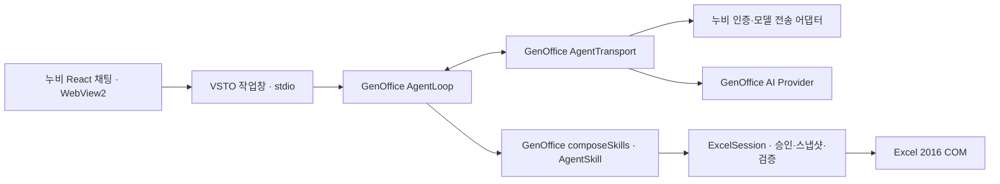

# 누비 연결·채팅 통합과 GenOffice 확장 구조

2026-10-13 · Office X 0.2.0 소스. 현재 누비 Workspace의 공통 인증과 채팅 컴포넌트를 재사용한다. 사용자의 마지막 결정대로 Agent 엔진은 GenOffice를 유지한다.

## 엔진의 기준

- `vendor/genoffice`의 agent-core와 ai-provider 85개 파일은 원본 그대로다.
- `runtime-src/agent.ts`가 실제 `AgentLoop`, `composeSkills`를 사용한다. 도구 인자 검사, 도구 실행 반복, 실패 피드백, 답변 검증, 문맥 압축, 사용량 이벤트, 취소를 계속 GenOffice가 처리한다.
- `additionalSkills`로 GenOffice `AgentSkill`을 추가할 수 있다. 누비의 도구·Agent 규격으로 다시 작성할 필요가 없다. 신뢰된 호스트 코드에서 등록하며 모델이 동적으로 실행 코드를 등록하는 기능은 없다.
- `runtime-src/nubi-transport.ts`는 GenOffice `AgentTransport` 구현이다. 로그인된 누비 모델 호출의 메시지·도구·스트림만 변환한다. GenOffice AI Provider의 기존 직접 연결 경로도 남아 있다.
- 누비 ChatGPT 전송부가 사용하는 `pi-ai`는 제공자 프로토콜 어댑터로만 포함된다. `pi-agent-core`와 누비 `runAgent`는 포함하지 않는다. 원본 `toPi`의 메시지 변환 함수만 분리했으며 출처·해시를 기록했다. 빌드가 두 번째 Agent 엔진 유입을 검사하고 `verification/runtime-modules.json`을 남긴다.
- GenOffice의 새 skill·검증·압축 기능은 이 계층에 추가한다. VSTO에서 지원할 문서 편집은 COM 어댑터와 네이티브 검증을 함께 구현한다. GenOffice 외부 파일 파서나 저장 엔진으로 보호 문서를 우회하지 않는다.

## 실제 재사용한 누비 코드

| 기능 | 원본 |
| --- | --- |
| AI Pro 로그인·코드 교환·모델 조회, ChatGPT OAuth·갱신, FabriX 연결 | `packages/nubi-office/worker/providers.mjs`와 관련 모듈; 현재 Workspace도 이 공통 모듈 사용 |
| Claude 로그인·모델 조회·한 번의 응답 전송 | 현재 Workspace의 `desktop-providers.mjs`, `claude-code.mjs`, `claude-login.mjs`, `claude-stream.mjs` |
| ChatGPT 계정 모델 목록 | `packages/nubi-desktop/runtime/chatgpt-catalog.mjs` |
| 로그인 단계·실패 안내 | `packages/nubi-desktop/ui/provider-login-state.mjs` |
| 로그인 화면·작성 입력창 | `extensions/aipro-chat/src/NubiSurfaces.jsx` |
| 모델 검색·제공자 전환·목록 갱신·로그아웃 | `extensions/aipro-chat/src/ChatControls.jsx` |
| 대화 자동 스크롤·최신 메시지 이동 | `packages/nubi-desktop/ui/useConversationScroll.js` |
| 실제 응답 경과 시간 | `packages/nubi-desktop/ui/ResponseTime.jsx` |
| 누비 캐릭터·색상 토큰·공통 컨트롤 | AgentMark, agent-deck.css, CX 0.5.4 |

`vendor/nubi-workspace-source.json`에 88개 원본 파일·자산 및 분리한 변환 함수의 출처를 기록했다. 복사한 원본 모듈은 수정하지 않았다. 누비 저장소도 변경하지 않았다.

## Workspace 시각 스타일

공통 `agent-deck.css`만 사용하던 화면에 현재 Workspace의 최종 `workspace-identity.css`, `ios-tokens.css`, `workspace-typography.css`, `workspace-density.css`, `workspace-dialogs.css`와 공통 `app.css`를 원본 그대로 추가했다. `ui/office.css`는 Office 작업창의 폭·배치와 공유 스타일을 Office 요소에 연결하는 역할을 맡는다.

폰트 스택은 Workspace의 Pretendard Variable → Pretendard → Noto Sans KR 순서다. 기존 CX 패키지의 로컬 Noto Sans KR 파일을 포함하며 Pretendard가 설치되어 있지 않으면 이 폰트를 사용한다. Pretendard 자체를 새로 번들한 것은 아니다. 본문 16px, UI 15px, 보조 글씨 14px, 기본 잉크 #191F28, 보조 잉크 #596574를 적용했다. 대화는 Workspace 최종 규칙의 흰 배경·중립색 말풍선이며 환영 화면만 연한 그라데이션이다. AI Pro는 연한 파랑·보라 그라데이션, ChatGPT는 중립색, FabriX는 민트, Claude는 #F9EDE7 배경과 #8E422C 포인트를 사용한다. 검증 완료 결과는 Workspace의 초록 상태색을 따른다.

최종 브라우저에서 폰트 스택·본문/보조 크기·Claude 색을 확인했고, 로그인·채팅·모델 선택 화면을 `verification/*.png`에 저장했다. 이는 모의 호스트 화면 검증이다.

[채팅 CX 비교 및 기능 보존 결과](cx-comparison.md): 원본 CSS와 38개 계산 스타일/토큰 일치, 추론 슬라이더·공통 입력줄 재사용.

## 연결과 저장

AI Pro·ChatGPT는 원본 로그인 흐름이 기본 브라우저를 열고 임시 localhost 콜백을 받는다. Office의 채팅 WebView에는 인증 페이지를 올리지 않는다. 로그인 취소·인증 교환·모델 조회 단계와 오류는 누비 코드가 제공한다. Workspace 내부 브라우저 자체는 이식하지 않았다.

FabriX는 서버 주소·클라이언트 키·토큰을 입력한 뒤 모델을 조회한다. 목록은 계정/서비스가 반환한 모델을 사용한다. 실행 중에는 제공자·모델 전환을 금지한다. 추론 수준은 제공자가 허용한 항목을 사용한다.

인증 정보는 stdio의 별도 `vault_write` 메시지로 VSTO 호스트에 전달한다. 호스트는 이를 WebView로 전달하지 않고 Windows DPAPI CurrentUser로 암호화해 `%LOCALAPPDATA%/OfficeX/Connections/`에 저장한다. 평문 저장 대체 경로는 없다. 새 작업창은 이 Office X 전용 저장소에서 복원하고 서버의 모델 목록·인증을 다시 확인한다. 다른 누비 앱·브라우저의 인증 저장소는 읽지 않는다. Claude 인증은 공식 CLI에 위임하며 Office X가 CLI 인증 파일이나 토큰을 추출하지 않는다. 저장/삭제 실패는 연결 상태에 표시한다. 실제 Windows DPAPI 실행은 별도 검증 대상이다.

## Claude 연결

누비 Workspace와 같은 공식 Claude Code CLI 연결을 사용한다. `auth status`로 로그인 여부를 확인하고 필요하면 `auth login`의 공식 브라우저 인증을 연다. 계정 인증은 CLI가 소유하며 Office X 저장소에는 선택 모델·추론 수준 등 연결 메타데이터만 보관한다. “연결 해제”는 Office X 연결만 해제하며 CLI 계정 전체를 로그아웃시키지 않는다.

모델 목록과 추론 수준은 CLI 초기화 응답을 사용한다. 매 모델 턴은 `--safe-mode --tools "" --strict-mcp-config --mcp-config '{"mcpServers":{}}' --disable-slash-commands --no-session-persistence --disallowedTools "mcp__*"`로 실행한다. Excel 도구는 구조화된 제안으로만 반환되며 GenOffice의 도구 검사와 네이티브 승인을 거친다. CLI는 Excel·파일·셸 작업을 실행하는 별도 Agent로 연결되지 않는다.

CLI가 없거나 필요한 옵션을 지원하지 않으면 설치/업데이트 안내를 표시한다. 공식 [Windows 설치 안내](https://code.claude.com/docs/en/setup#install-on-native-windows)를 따른다. 실제 계정과 Windows CLI 실행은 미검증이며 테스트는 CLI 출력과 인증 과정을 모의했다.

## 대화와 문서 실행

채팅은 Markdown·표·코드, 실시간 답변, 중지, 답변 복사, 실제 경과 시간, 새 대화와 최근 20개 대화 이력을 제공한다. 대화는 현재 작업창 메모리에만 유지하며 재시작 후 복원하지 않는다. 이전 대화는 같은 문서 ID·시트 ID·범위에서만 제한된 최근 텍스트로 이어진다. 이전 도구 호출 ID, 스냅샷과 승인은 재사용하지 않는다. 문서가 바뀌면 모델의 이전 문서 문맥을 이월하지 않는다.

변경안은 C# 네이티브 실행기가 만들며 사용자 승인은 runId와 planId에 결합된다. 승인 시 원본을 다시 검사하고 수식과 계산값을 조회한다. 채팅 문장과 검증 결과를 구분한다. 모델이 승인 메시지를 만들거나 작업창에서 임의 COM 명령을 실행할 경로는 없다. WebView 탐색·다운로드·권한 요청은 차단하고 로컬 UI 출처의 제한된 메시지만 수신한다.

현재 Excel 수정 기능은 빈 셀에 숫자 셀 둘의 곱셈 수식을 넣는 첫 단계다. GenOffice 전체 편집 기능이 이미 동작한다는 의미는 아니다. 계정 사용량 대시보드, 파일 첨부, 메일·Wiki·파일 탐색, A2A 활성화는 이번 통합에 포함하지 않았다.

## 검증 경계

실제 소스 빌드, GenOffice 테스트, 인증/모델의 모의 서비스 테스트, stdio 연결 테스트, 브라우저 UI 조작을 확인했다. 화면의 테스트 모델과 실행 내역은 fixture다. 실제 계정 로그인, Windows WebView2·DPAPI, VSTO 로드, Excel COM·NASCA 실행을 증명하지 않는다.
